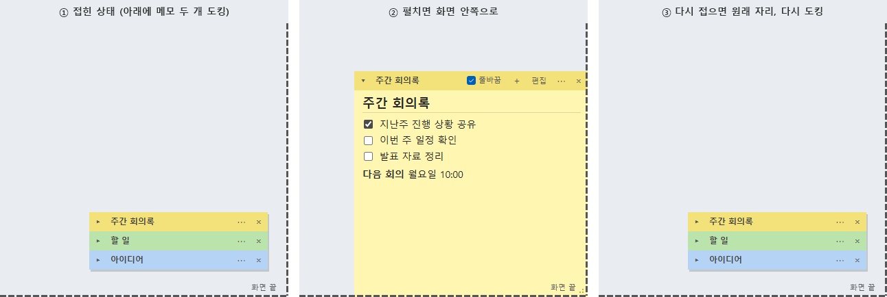

# 꼭!! 꼭!!

> **꼭!!**  지정된 프로그램을 지정된 시간에 빽그라운드로 실행하기!!  
> **꼭!! 꼭!!** 필요한 기능들을 모아~~ 모아~~

<!-- kkokkkok-release:start (srcs/release.sh 가 배포할 때 이 사이를 바꿈) -->
**최신 버전 0.0.6** (2026-11-25) · [내려받기](https://github.com/x-khai/khai-kkokkkok.deploy/releases/latest) · [지난 버전들](https://github.com/x-khai/khai-kkokkkok.deploy/releases)

0.0.5 를 쓰고 있다면 트레이 메뉴 "설정 > 업데이트 확인…" 에서 바로 설치할 수 있어요.

## 화면 끝에서 메모 펼치기·접기
- 펼친 메모가 모니터 밖으로 나가지 않게 안쪽으로 펼쳐요 (오른쪽 끝이면 왼쪽으로, 아래 끝이면 위로)
- 펼친 뒤 옮기지 않고 접으면 원래 자리로, 옮겼으면 그 자리에서 접혀요. 모니터 끝에 붙어 있으면 접어도 끝에 붙어 있어요
- 아래에 도킹된 메모가 있으면 펼쳐도 밀어내지 않아요 — 화면 아래쪽에서 펼치면 도킹된 메모가 화면 밖으로 밀려나 다시 꺼낼 수 없던 문제.
  다시 접으면 다시 도킹돼요 (펼친 채 옮겼으면 접힌 자리 아래로 따라옴)

## 업데이트는 실행 파일만
- 업데이트할 때 꼭꼭 실행 파일과 `config.json.template` 만 바꿔요. 설정(`config.json`)과 고쳐 쓰는 `scripts` 는 그대로예요
- 0.0.5 에서 올릴 때부터 적용돼요 (업데이트는 받은 새 버전이 설치하므로). 0.0.4 이하에서 바로 올리면 예전 방식이라
  `scripts` 가 샘플로 바뀌고 원래 것은 `.bak` 으로 남아요
<!-- kkokkkok-release:end -->
