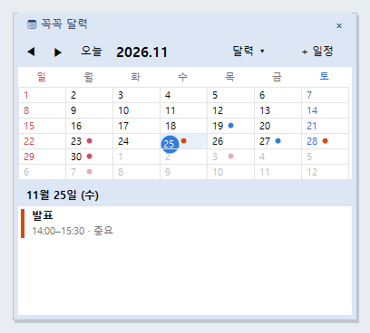
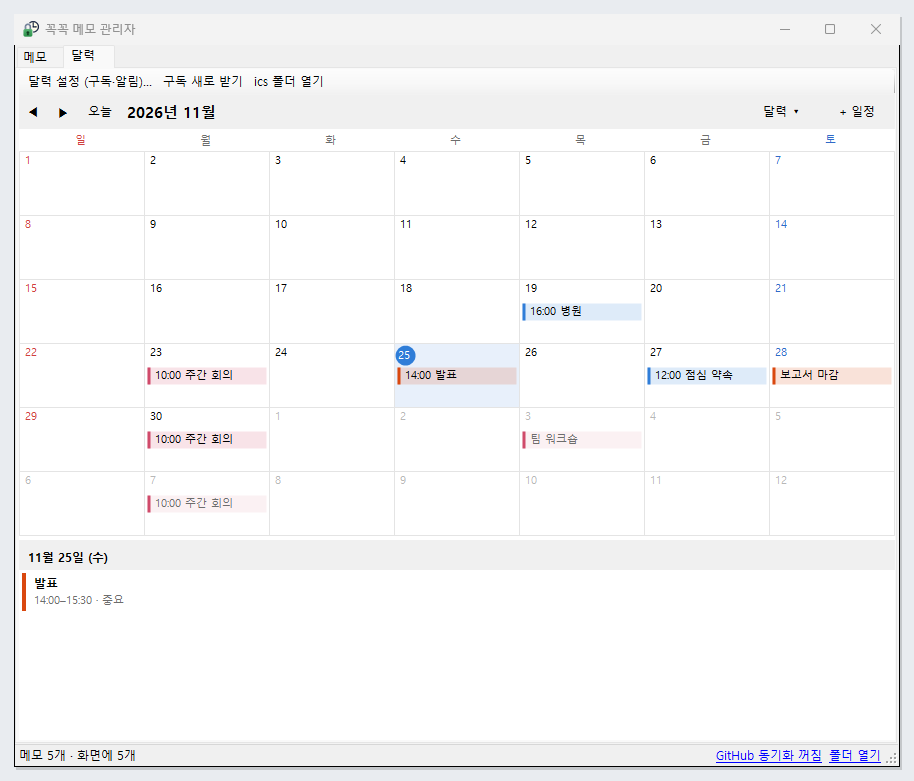
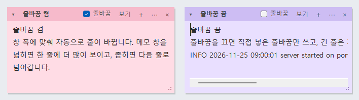
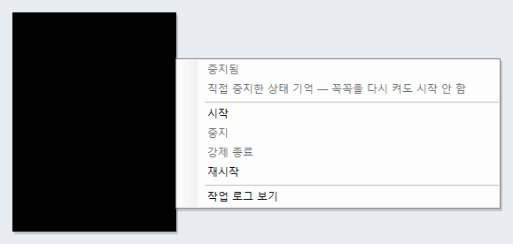

# 꼭!! 꼭!!

**꼭!!**  지정된 프로그램을 지정된 시간에 빽그라운드로 실행하기!!  
**꼭!! 꼭!!** 필요한 기능들을 모아~모아~  

## 달력
ics 일정(내 일정 + 구독 주소), 여러 달력(중요·개인·업무 …), 바탕화면 달력·트레이 달력, 알림, 일정·날짜에서 메모 만들기

## 메모 도킹
위·아래로 붙이면 끝선이 맞고, 맨 위 메모를 끌면 아래 메모들이 같이 움직입니다. 중간 메모를 끌면 그 메모만 떨어져 나와요.
메모 제목은 항상 한 줄로, 접힌 메모의 긴 제목은 클릭해서 펼칩니다.

## 메모 줄바꿈
머리줄의 "줄바꿈" 체크: 켜면 창 폭에 맞춰 자동 줄바꿈, 끄면 직접 넣은 줄바꿈만 쓰고 긴 줄은 가로 스크롤.

## 작업 상태 기억
트레이에서 직접 중지한 작업은 꼭꼭을 다시 켜도 시작하지 않습니다 (직접 시작한 작업은 다시 시작).

## 업데이트 확인·설치
이번 버전부터 새 버전이 나오면 꼭꼭이 알려 주고, 트레이 메뉴에서 바로 설치할 수 있어요. ("설정 > 업데이트 확인…")
이번 0.0.3 은 한 번만 직접 받아서 설치해 주세요.

