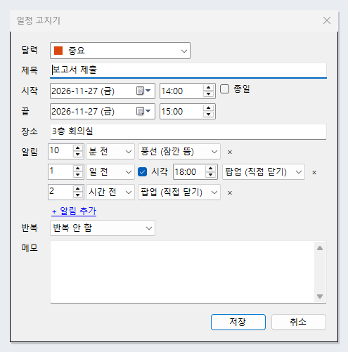
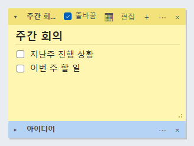
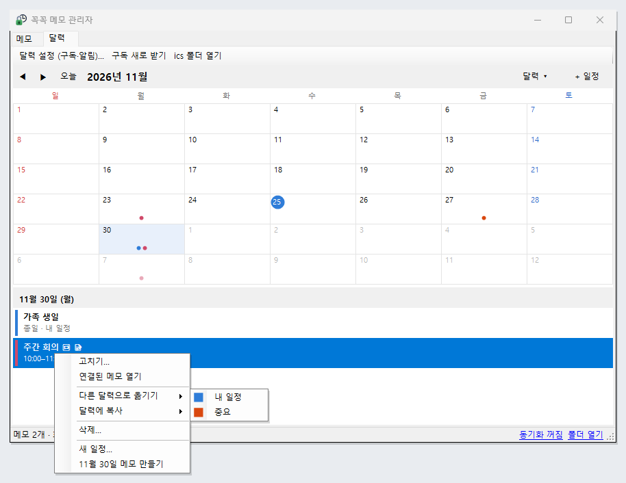
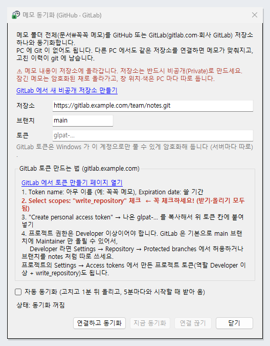
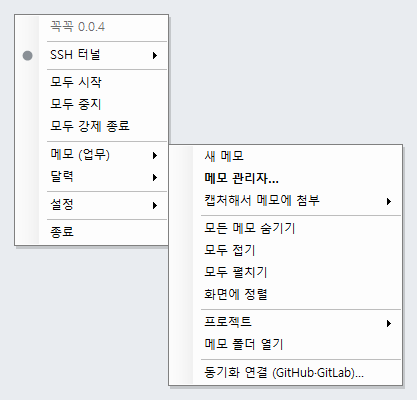

# 꼭!! 꼭!!

> **꼭!!**  지정된 프로그램을 지정된 시간에 빽그라운드로 실행하기!!  
> **꼭!! 꼭!!** 필요한 기능들을 모아~~ 모아~~

0.0.3 을 쓰고 있다면 트레이 메뉴 "설정 > 업데이트 확인…" 에서 바로 설치할 수 있어요.

## 일정 알림: 여러 개, 직접 설정, 꼭 봐야 하는 알림은 팝업
- 일정 하나에 알림을 여러 개 넣을 수 있어요. "10분 전", "2시간 전", "1일 전"
- "일 전" 알림은 **시각**을 정할 수 있어요 — "1일 전 18:00" 처럼 전날 정한 시각에 (끄면 정확히 24시간 전)
- 종일 일정은 "당일 09:00", "1일 전 18:00" 처럼 날짜와 시각을 따로
- 알림마다 방식: **풍선**(잠깐 떴다 사라짐) / **팝업**(확인을 누를 때까지 떠 있음, 소리 + 작업 표시줄 깜박임)
- 팝업은 "다시 알림"(5분·10분·30분·1시간 뒤), 꼭꼭이 꺼져 있던 동안 놓친 팝업은 다음에 켤 때 "놓친 알림"으로

## 알림을 누르면 달력에서 그 일정
풍선 알림을 누르면 달력이 그 날짜로 가서 그 일정을 골라 보여 줍니다.

## 일정과 연결된 메모에 📅
메모 머리줄과 메모 관리자 목록에 📅 가 붙고, 누르면 달력에서 연결된 일정으로 갑니다.

## 일정 복사·다른 달력으로 옮기기
달력에서 일정을 오른쪽 클릭 → "다른 달력으로 옮기기" / "달력에 복사". 반복 일정은 통째로, 구독 달력의 일정도 내 달력으로 복사할 수 있어요.

## 메모 동기화에 GitLab
gitlab.com 이나 회사 GitLab 저장소로도 동기화할 수 있어요. 주소에 맞춰 토큰 만드는 법을 보여 주고,
실패하면 토큰 권한(write_repository)·프로젝트 권한·보호 브랜치 중 무엇이 문제인지 알려 줍니다.

## 트레이 메뉴 정리
새 메모·메모 관리자·캡처는 "메모" 메뉴 안으로 옮겼어요.

## 그 밖에
- 같은 그림을 여러 번 눌러도 그림 창은 하나만
- 메모 관리자 미리보기의 "창으로 열기" 버튼이 잘리던 것
- 같은 달력에 똑같은 일정이 둘 있으면 하나만 보이던 것
- 메모 관리자 달력이 작을 때 일정이 안 보이던 것 (이제 색 점)
- 동기화 토큰이 틀렸을 때 원인 안내가 안 나오던 것
- 종일 일정 알림은 이제 그날 0시 기준(ics 규칙)이에요. 예전에 넣은 종일 일정 알림은 시각을 한 번 확인해 주세요.
