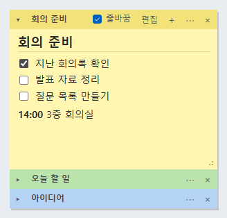
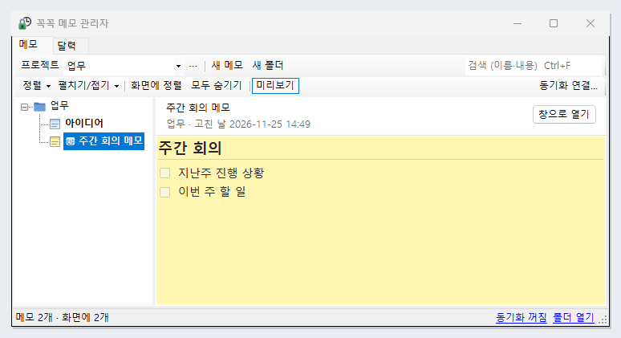
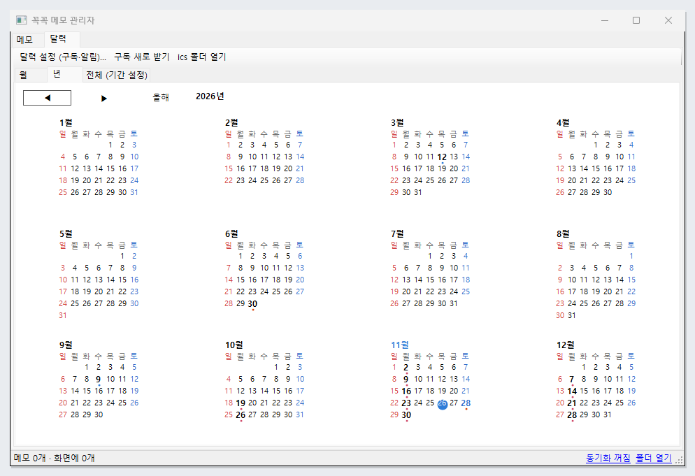
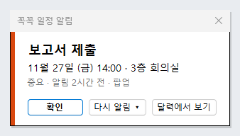
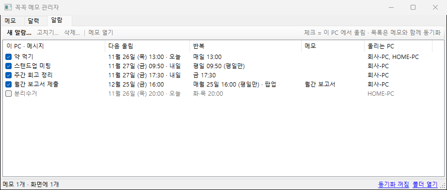

# 꼭!! 꼭!!

> **꼭!!**  지정된 프로그램을 지정된 시간에 빽그라운드로 실행하기!!  
> **꼭!! 꼭!!** 필요한 기능들을 모아~~ 모아~~

**최신 버전 0.1.0.0** (2026-11-28) · [내려받기](https://github.com/x-khai/kkokkkok/releases/latest) · [버전별 바뀐 점](https://github.com/x-khai/kkokkkok/releases)

꼭꼭은 Windows 트레이에 조용히 앉아서, 매일 손으로 띄우던 프로그램을 대신 켜 두고,
떠오른 생각은 포스트잇 메모로, 챙겨야 할 일정은 달력으로 붙잡아 두는 작은 도우미예요.
설치할 것도, 따로 깔아야 할 런타임도 없이 exe 하나면 됩니다.

## 이런 분께 꼭!!
- 출근하면 서버·터널·스크립트를 하나하나 띄우고, 퇴근 전에 하나하나 끄는 분
- 메모장 창이 여기저기 흩어져 있고, 어디에 적었는지 늘 찾는 분
- 회의 알림을 놓쳐서 "아 맞다!" 를 자주 외치는 분
- 회사 PC 와 집 PC 의 메모·일정을 똑같이 맞춰 두고 싶은 분

## 꼭꼭이 하는 일

### 1. 백그라운드 실행 · 예약 실행
- 등록한 프로그램·스크립트(.exe · .cmd · .bat · .ps1)를 창 없이 띄워 두고, 꺼지면 다시 켜 줘요
- "평일 9시", "30분마다" 처럼 **예약 실행** (cron 식도 그대로)
- **실행 조건**: "서버가 켜져 있을 때만", "디스크가 꽂혀 있을 때만" — 확인 명령이 통과할 때만 시작하고, 기다리는 동안은 노란 점으로
- 트레이 아이콘 색으로 상태를 한눈에, 메뉴에서 시작·중지·강제 종료·로그 보기
- 직접 중지해 둔 작업은 꼭꼭을 다시 켜도 그대로 중지 — 내 손이 마지막에 정한 대로

### 2. 포스트잇 메모
- 바탕화면에 붙는 메모. **마크다운**으로 쓰면 보기 모드에서 깔끔하게 (체크박스·표·코드·**Mermaid** 그림까지)
- 메모끼리 자석처럼 **붙이고**, 위·아래로 붙여 묶어서 함께 옮기고, 접어서 제목만 남기기
- **암호 잠금**(AES-256), 파일 **첨부**, 화면 **캡처**(영역·창·전체·스크롤)를 바로 메모에
- 프로젝트·폴더로 정리하고, 메모 관리자에서 찾아보기·미리보기 (트레이 아이콘을 두 번 누르면 바로 열려요)
- 색은 기본 6가지에 **원하는 색 아무거나**, 중요한 메모는 **삭제 금지**로 실수로 지우지 않게
- **Ctrl+F** 로 메모 안 찾기, 메모 관리자에서는 **어느 메모 몇째 줄**인지까지 찾아서 바로 그 자리로
- 손에 익은 편집 그대로: **vi 모드**(`:w` `/검색` `ciw` …)와 **세로 블럭 편집**(Alt+끌기)

### 3. 달력 · 알림
- Outlook·Google 과 같은 **ics** 형식으로 저장하고, 회사·공유 달력은 ics 주소로 **구독**해서 함께 보기
- 중요·개인·업무처럼 **달력을 여러 개**, 월 · 년 · 전체 목록으로 한눈에
- 일정마다 **알림 여러 개** — "1일 전 18:00" 처럼 시각까지. 꼭 봐야 하는 알림은 **확인할 때까지 떠 있는 팝업**으로, 나머지는 원하는 초만큼 잠깐
- 일정에서 바로 메모를 만들고, 메모에서 바로 그 일정으로
- 반복 일정은 **평일만**도 — 토 · 일 · 공휴일에 걸리면 그 앞의 평일로 (15일이 쉬는 날이면 14일, 13일 …) (대한민국 공휴일 구독 한 번이면)

### 4. ⏰ 알람 — 메모에 걸어 두는 알림
- 일정이 아니어도 "매일 13:00 약 먹기", "평일 09:50 스탠드업", "매월 25일 보고서 제출" 처럼 **시각 + 메시지**만으로
- 메모에 걸어 두면 울릴 때 **바로 그 메모가 열려요** — 해야 할 일의 내용까지 한 번에
- 메모 관리자의 알람 탭에서 한눈에. 목록은 PC 끼리 같이 보고, 울리는 것은 PC 마다

### 5. 여러 PC 에서 같이 — GitHub · GitLab 동기화
- 메모·달력을 내 비공개 저장소(GitHub·GitLab·회사 GitLab)와 동기화. PC 에 Git 이 없어도 돼요 (내장)
- 고친 이력이 그대로 남고, 두 PC 에서 같은 메모를 고쳐도 사라지지 않게 사본으로 남겨요
- 잠긴 메모는 암호화된 채로만 올라가요

### 6. 알아서 최신 버전으로
- 새 버전이 나오면 트레이에서 알려 주고, 누르면 받아서 설치하고 다시 켜져요. 설정·메모·내 스크립트는 그대로
- 받은 파일은 꼭꼭 배포 키의 서명을 확인한 뒤에만 설치해요 (서명이 없거나 다르면 설치하지 않아요)

## 시작하기
1. 위의 **내려받기**에서 `khai-kkokkkok.v….zip` 을 받아 원하는 폴더(예: `D:\tools\khai-kkokkkok`)에 풀어요
   — 나만 쓸 수 있는 폴더에 두세요. `config.yaml` 에 적은 명령은 로그인할 때마다 실행되므로, 다른 사람이 고칠 수 있는 폴더(공유 폴더 등)는 피해요
2. `khai-kkokkkok.exe` 를 실행하면 트레이에 꼭꼭 아이콘이 생겨요 (Windows 10 · 11, 64비트)
3. 트레이 아이콘 → **설정 > 실행설정…** 에서 띄워 둘 프로그램을 추가하고, **Windows 시작 시 자동 실행**을 켜 두면 끝

| 단축키 | 하는 일 |
|---|---|
| `Ctrl+Alt+N` | 새 메모 |
| `Ctrl+Alt+H` | 메모 모두 숨기기·보이기 |
| `Ctrl+Alt+D` | 달력 |
| `Ctrl+Alt+A` / `W` / `F` / `S` | 영역 / 창 / 전체 / 스크롤 캡처 → 메모에 첨부 |

## 내 데이터는 내 PC 에
- 설정은 꼭꼭 폴더의 `config.yaml` (주석을 달아 두기 좋은 YAML), 이 PC 의 상태(구독 주소 · 알람 상태 · 토큰 등)는 꼭꼭 폴더의 `data\` 한곳에 — 폴더째 옮기면 그대로 따라가요
- 메모 · 달력 · 알람은 `문서\꼭꼭 메모` 에 보통 파일(.md · .ics · .json)로 저장돼요 — 꼭꼭이 없어도 열어 볼 수 있어요
- 동기화를 켜기 전에는 어디로도 보내지 않아요. 토큰은 Windows 가 이 계정으로만 풀 수 있게 암호화해 둬요
- 메모 속 인터넷 그림은 기본으로 불러오지 않고 링크로 보여 줘요 (열어 본 것만으로 남의 서버에 기록이 남지 않게, `config.yaml` 의 `noteRemoteImages` 로 바꿀 수 있어요)
